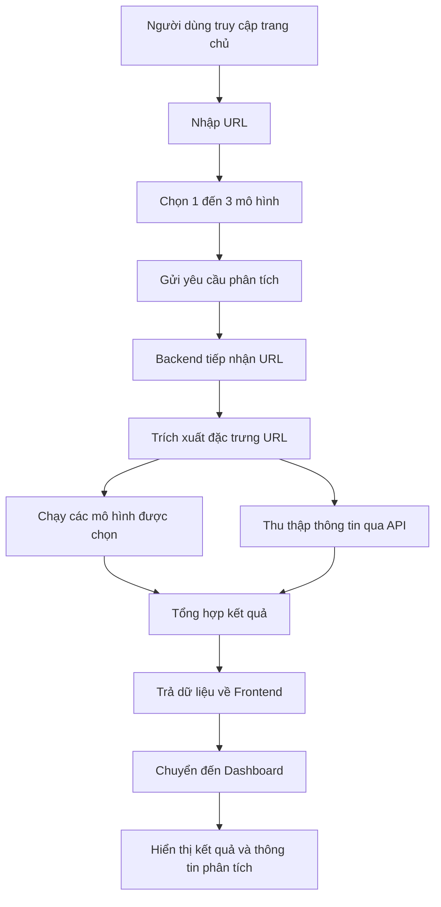

# 🔍 Hệ thống nhận diện URL độc hại (Malicious URL Detection)

## 1. Giới thiệu

Hệ thống nhận diện URL độc hại là ứng dụng hỗ trợ phân tích và đánh giá mức độ an toàn của một URL thông qua các mô hình Machine Learning và Deep Learning.

Người dùng có thể nhập URL cần kiểm tra và chủ động lựa chọn từ 1 đến tối đa 3 mô hình để thực hiện dự đoán. Sau khi quá trình phân tích hoàn tất, hệ thống chuyển đến trang Dashboard để hiển thị kết quả dự đoán của từng mô hình cùng với các thông tin phân tích bổ sung được trích xuất thông qua API và các thư viện hỗ trợ.

### Mục tiêu

- Phát hiện và phân loại các URL có dấu hiệu độc hại.
- Cho phép sử dụng nhiều mô hình để đánh giá cùng một URL.
- Hỗ trợ so sánh kết quả dự đoán giữa các mô hình.
- Cung cấp thêm thông tin về URL và domain nhằm giúp người dùng hiểu rõ hơn về kết quả phân tích.
- Trực quan hóa kết quả thông qua giao diện Dashboard.

## 2. Chức năng chính

### 2.1. Trang chủ – URL Analysis

Người dùng thực hiện các thao tác:

- Nhập URL cần kiểm tra.
- Lựa chọn mô hình dự đoán.
- Cho phép chọn tối thiểu 1 và tối đa 3 mô hình.
- Bắt đầu quá trình phân tích URL.

Các mô hình hiện tại:

| Mô hình | File |
|---|---|
| Bayesian BERT | `bayesian_bert_checkpoint.pth` |
| BERT Phishing | `bert_phishing_final.pth` |
| Neural Symbolic BERT | `neural_symbolic_bert.pth` |

### 2.2. Xử lý và dự đoán

Sau khi người dùng gửi yêu cầu, hệ thống thực hiện:

1. Tiếp nhận và kiểm tra URL đầu vào.
2. Trích xuất các đặc trưng cần thiết từ URL.
3. Đưa dữ liệu qua các mô hình được người dùng lựa chọn.
4. Thu thập kết quả dự đoán từ từng mô hình.
5. Trích xuất các thông tin bổ sung thông qua API và thư viện hỗ trợ.
6. Tổng hợp dữ liệu và trả kết quả về giao diện.

### 2.3. Dashboard – Kết quả phân tích

Sau khi xử lý hoàn tất, người dùng được chuyển đến trang Dashboard.

Dashboard hiển thị:

**Kết quả dự đoán**
- URL được kiểm tra.
- Kết quả phân loại của từng mô hình.
- Xác suất hoặc độ tin cậy dự đoán (nếu mô hình hỗ trợ).
- So sánh kết quả giữa các mô hình.

**Thông tin URL và Domain**

Các thông tin bổ sung được thu thập thông qua API và thư viện, tùy thuộc vào khả năng hỗ trợ của từng nguồn dữ liệu. Ví dụ:

- Domain và subdomain.
- Tên miền mở rộng (TLD).
- Địa chỉ IP của domain.
- Thông tin DNS.
- Thời gian đăng ký domain.
- Thông tin SSL/TLS.
- Số lượng redirect.
- URL cuối cùng sau khi chuyển hướng.
- Các đặc trưng cấu trúc của URL.

**Thông tin tổng quan**
- Tổng số mô hình được sử dụng.
- Kết quả đánh giá tổng hợp.
- Những dấu hiệu đáng chú ý trong quá trình phân tích.

## 3. Luồng hoạt động của hệ thống

## 4. Công nghệ sử dụng

| Thành phần | Công nghệ |
|---|---|
| Backend | Python |
| Frontend | Đang phát triển |
| Machine Learning / Deep Learning | PyTorch |
| Mô hình dự đoán | Bayesian BERT, BERT Phishing, Neural Symbolic BERT |
| API | Các API hỗ trợ thu thập thông tin URL và Domain |
| Quản lý môi trường | Python Virtual Environment |

## 5. Cấu trúc thư mục

### Mô tả các thư mục

| Thư mục / File | Chức năng |
|---|---|
| `backend/` | Chứa mã nguồn xử lý phía máy chủ. |
| `backend/controllers/` | Xử lý các yêu cầu và điều phối nghiệp vụ. |
| `backend/routes/` | Định nghĩa các API endpoint. |
| `backend/services/` | Chứa logic xử lý URL, trích xuất đặc trưng và dự đoán. |
| `backend/app.py` | Điểm khởi chạy ứng dụng Backend. |
| `backend/test.py` | Kiểm thử các chức năng Backend. |
| `frontend/` | Chứa mã nguồn giao diện người dùng. |
| `models/` | Lưu trữ các mô hình đã được huấn luyện và dữ liệu kiểm thử. |
| `.venv/` | Môi trường Python ảo của dự án. |

## 6. Kết quả mong đợi

Hệ thống hướng đến việc cung cấp một giao diện phân tích URL trực quan, cho phép người dùng:

- Kiểm tra một URL bằng nhiều mô hình khác nhau.
- So sánh kết quả dự đoán giữa các mô hình.
- Quan sát các thông tin kỹ thuật liên quan đến URL và Domain.
- Có thêm cơ sở để đánh giá mức độ an toàn của một URL.

